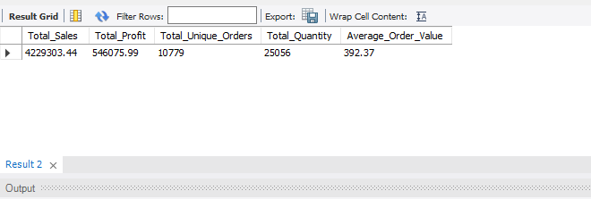
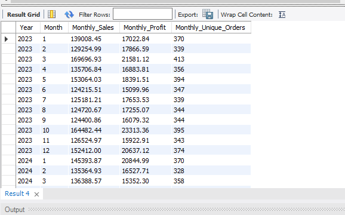
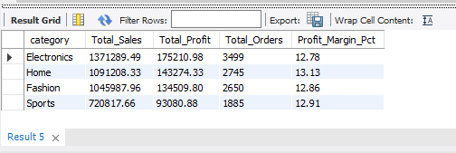
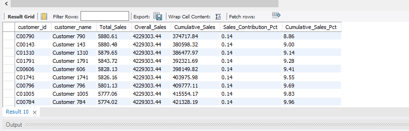
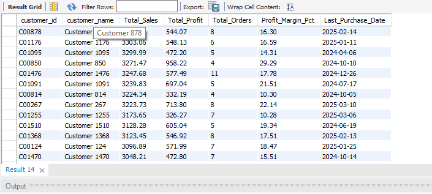
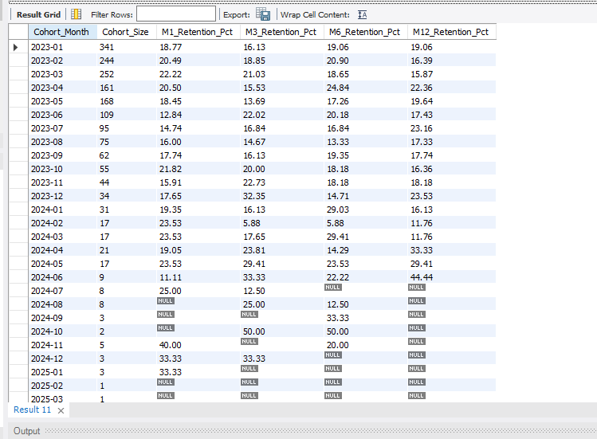
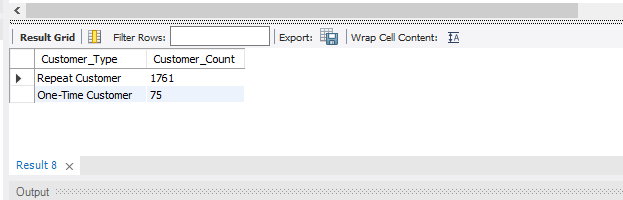
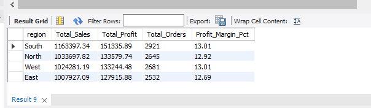

# E-Commerce Sales & Customer Analytics

## Project Overview

This project uses SQL to explore e-commerce sales, product performance,
customer behaviour, regional performance, discounts, and other business
questions.

The project contains 13 SQL scripts, along with folders for data,
results, and screenshots.

## Project Structure

``` text
E-Commerce-SQL-Analytics/
├── data/
│   └── ecommerce.csv
├── screenshots/
│   ├── executive_kpis.png
│   └── other analysis screenshots
├── 01_data_cleaning.sql
├── 02_data_validation.sql
├── 03_executive_kpis.sql
├── 04_sales_analysis.sql
├── 05_product_analysis.sql
├── 06_customer_analysis.sql
├── 07_regional_analysis.sql
├── 08_discount_analysis.sql
├── 09_rfm_analysis.sql
├── 10_cohort_analysis.sql
├── 11_abc_analysis.sql
├── 12_advanced_sql_analysis.sql
├── 13_business_investigation.sql
└── README.md
```

## SQL Topics Covered

-   Data cleaning and validation
-   Executive KPIs
-   Sales trends and performance
-   Product analysis
-   Customer analysis
-   Regional analysis
-   Discount analysis
-   RFM analysis
-   Cohort analysis
-   ABC analysis
-   Advanced SQL analysis
-   Business investigation

## Project Screenshots

The following screenshots show selected SQL analysis results:

1. **Executive KPIs** – Overall business performance metrics.
   - `executive_kpis.png`
   - 

3. **Monthly Sales & Profit Trend**
   - `Monthly_Sales_Profit_Trend.png`
   

5. **Category Performance**
   - `Category_Performance.png`
  

7. **Customer Sales & Cumulative Contribution**
   - `Customer_Sales_and_Cumulative_Contribution.png`  
   

9. **High Value Inactive Customers**
   - `High_Value_Inactive_Customers.png`
   

11. **Customer Retention by Cohort**
    - `Month_1_3_6_12_Retention_by_Cohort.png`
   

13. **One-Time vs Repeat Customers**
   - `One_Time_VS_Repeat_Customers.png`
  

15. **Regional Performance**
   - `Region_Wise_Performance.png`
   
 
## Database Setup

1.  Open MySQL Workbench and connect to your MySQL server.
2.  Confirm the database and table names in the SQL scripts match your
    local setup.
3.  Run the scripts in a suitable order, starting with data cleaning and
    validation.
4.  Review the outputs and save relevant results or screenshots in the
    `results/` and `screenshots/` folders.

The database used during development is named:

``` sql
`e-commerce sales & customer analytics`
```

The tables checked during development are `ecommerce` and
`ecommerce_clean`.

## Data Quality Note

During validation, the source table showed inconsistent
product-to-category and product-to-subcategory mappings. Each of the 350
product IDs appeared with multiple categories and multiple
subcategories, while each product ID was associated with only one
product name.

No verified product master table was available in the database to
confirm the intended mapping. Therefore, category-wise product rankings
should be treated cautiously, and product-category mappings have not
been manually invented or changed to make the results appear consistent.

This limitation was observed in the source dataset as well as the
cleaned dataset. The checks do not establish the original cause of the
inconsistency.

## Important Notes

-   SQL scripts were run in MySQL Workbench during project development.
-   Results depend on the dataset and database environment used.
-   Review the SQL scripts before running them against any database,
    especially scripts that create, drop, or modify tables.
-   Add final screenshots and selected result files to the repository
    where appropriate.

## Project Status

The 13 SQL scripts have been run by the project author, and the author
reported that all queries execute successfully in the current
environment. This confirms query execution in that environment; it does
not independently verify every business interpretation or the quality of
the source data.
